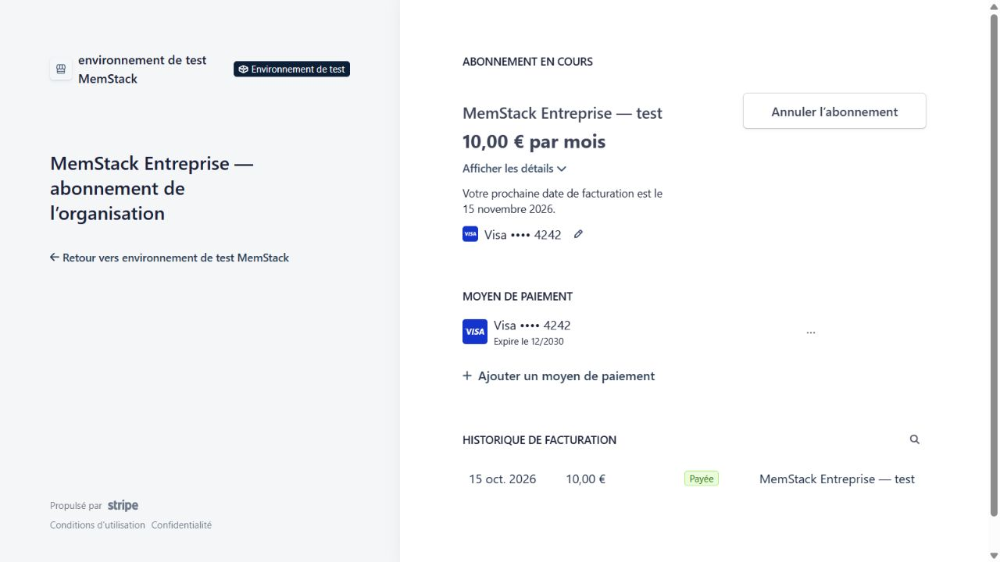
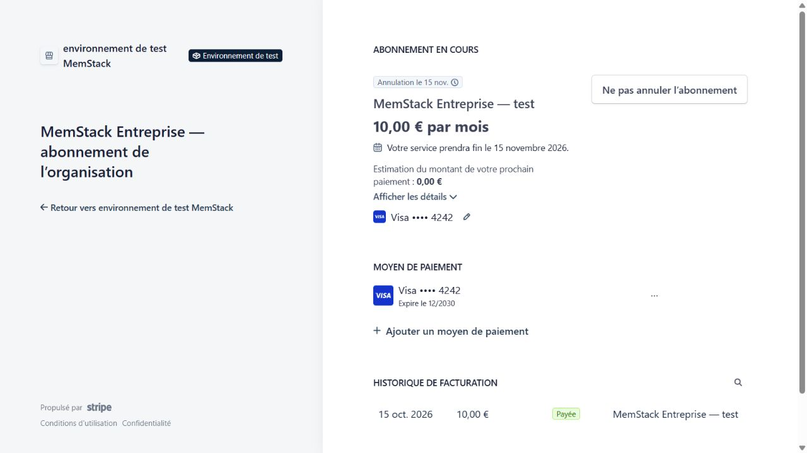

# Déploiement backend Entreprise — 15 octobre 2026

Le propriétaire a explicitement autorisé le déploiement du backend en mode TEST et l’utilisation d’Eventarc/Pub/Sub nécessaires à la qualification. Le frontend n’est pas publié par cette opération ; la PR Entreprise reste distincte de `main`.

## Infrastructure vérifiée

Projet Firebase existant `memstack-9f581`, région `europe-west9`, Node.js 24, Functions v2. Les règles Firestore sont publiées. Les treize fonctions concernées sont actives : les neuf callables Entreprise, le worker `syncEnterpriseMemberQuantity`, le webhook Stripe et les deux fonctions d’export/suppression de compte mises à jour.

Les paramètres déployés ont été relus : `ENTERPRISE_SUBSCRIPTIONS_ENABLED=true`, `ENTERPRISE_SUBSCRIPTIONS_LIVE_MODE=false`, `maxInstanceCount=2`. Les créations/paiements/portail TEST restent réservés aux comptes de qualification bénéficiant du droit permanent existant. Le tarif et le portail sont exclusivement TEST. Les paramètres du Premium personnel et les seuils budgétaires n’ont pas été modifiés.

La première création du worker a rencontré le délai de propagation des permissions du service Eventarc. Une nouvelle tentative ciblant uniquement le worker a réussi. Les filtres du trigger portent sur la base `(default)` et le chemin `_enterpriseSeatSync/{organizationId}` ; le worker utilise le compte de service Google existant. Les premières écritures effectuées pendant la propagation du trigger ont ensuite été remplacées par de nouvelles mutations de qualification. La recette valide les événements émis après activation complète, pas la reprise rétroactive de la fenêtre initiale de déploiement.

## Recette Stripe et Firestore réels, données fictives

Une organisation isolée, nommée « Qualification technique — TEST fictif », a été créée avec des identifiants de membres fictifs qui ne correspondent à aucun compte Auth. Aucun progrès ni droit personnel d’un utilisateur réel n’a été modifié. La préparation de cette organisation utilise les outils serveur privilégiés ; elle ne constitue pas une recette authentifiée positive des callables dans le navigateur.

1. Checkout Managed Payments TEST : carte de test Stripe, montant de 1 000 centimes EUR, facture payée. Le webhook déployé reçoit la notification Stripe et enregistre l’entitlement actif d’une place. Le retour de cette session de qualification est local pour éviter la navigation vers le frontend non publié ; les URL fixes du code de production ont été vérifiées lors de la recette SDK précédente.
2. Portail TEST : la facture fictive apparaît comme payée, l’abonnement à 10 € par mois est visible et la modification manuelle des places n’est pas proposée.
3. Ajout d’un membre fictif : transaction serveur et tâche durable, puis déclencheur Eventarc réel. Stripe passe à deux places, l’entitlement à deux places et la révision est acquittée automatiquement, sans appel manuel au worker.
4. Retrait de ce membre : Stripe et l’entitlement reviennent à une place, avec acquittement automatique de la révision suivante. Les ajustements utilisent le comportement de prorata prévu par le backend ; aucune facture de modification immédiate n’est émise.
5. Résiliation dans le portail TEST : la fin de service est annoncée au 15 novembre 2026. Le webhook conserve la période payée et expose `cancelAtPeriodEnd=true`, y compris lorsque Stripe fournit `cancel_at` plutôt que le booléen `cancel_at_period_end`.
6. Déduplication : un événement TEST déjà traité est renvoyé deux fois avec une signature de qualification valide. Les deux réponses sont HTTP 200, sans changement de l’entitlement enregistré.
7. Fermeture de l’organisation fictive : suppression de ses accès actifs, révocation immédiate de son entitlement et tâche de quantité zéro. Résultat final relu : abonnement Stripe `canceled`, zéro membre actif, organisation désactivée, entitlement `inactive`, `seatLimit=0`, `paidUntil=null`, révision 6 acquittée et zéro échec du worker. Aucun abonnement de cette qualification n’est laissé actif.

Les requêtes sans authentification/App Check sont refusées par les callables contrôlés (`getEnterpriseWorkspace`, `createEnterpriseCheckout`, HTTP 401). Une notification sans signature Stripe est refusée par le webhook (HTTP 400). Le statut des Functions et leurs paramètres sont relus par API Google Cloud.

Les preuves opérationnelles sont dans `.npm-cache/enterprise-cloud-proof.json` et les scripts de qualification ignorés par Git. Elles ne contiennent aucun secret de fournisseur. Les URL de sessions sont conservées séparément dans des fichiers ignorés, jamais dans la documentation publiée.

## Limites et suite

Aucun paiement réel, tarif LIVE, changement de plafond budgétaire ou déploiement frontend n’a été effectué. La recette navigateur avec un utilisateur connecté sur localhost reste à compléter : la session Google n’a pas pu être établie dans le navigateur de qualification. Le contrôle automatique a refusé l’inspection de l’interface de production, incompatible avec le périmètre local de cette recette ; aucun contournement de cette restriction n’a été effectué.

Avant ouverture commerciale : terminer la recette utilisateur connecté, préparer les paramètres et ressources Stripe LIVE dédiés, puis publier le frontend compatible. Le présent document prouve le déploiement et les échanges TEST du webhook/worker, pas l’ouverture commerciale de l’offre.
