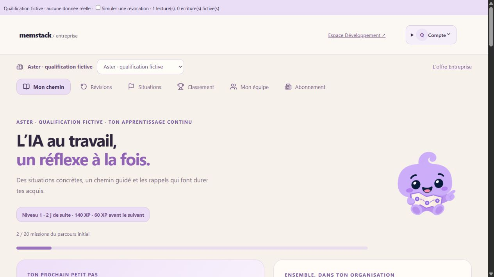
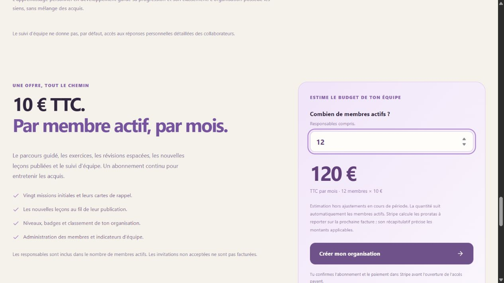

# Qualification Entreprise — 15 octobre 2026

## Périmètre livré

Deux environnements pour une même identité : Développement et Entreprise. Chaque organisation a sa progression, ses cartes, ses situations, ses pseudos, ses niveaux, ses badges et son classement. L’offre publique présente un abonnement continu à 10 € TTC par membre actif et par mois, responsables compris, avec invitations exclues tant qu’elles ne sont pas acceptées.

Le contenu comprend huit chapitres, vingt missions guidées, deux missions complémentaires, 66 cartes et huit situations de cinq questions. Il couvre notamment les demandes et critères de réussite, le contexte, les documents, les agents et leurs permissions, la vérification, la confidentialité, les coûts, les impacts environnementaux et le pilotage d’un projet. Les ateliers utilisent le cas fictif Aster. Trois photos d’illustration générées sont légendées comme telles. Voir les inspections et sources dans `docs/content/ENTERPRISE_*` et la provenance dans [ENTERPRISE_ASSETS.md](ENTERPRISE_ASSETS.md).

## Vérifications locales

- Build frontend et build Functions réussis. La suite principale passe, dont 75 tests serveur. Les 41 tests de la suite Firestore complète passent sur le projet d’émulateur `demo-memstack-challenge-ai`, y compris les tests d’isolation, d’autorisations, de transactions et de facturation simulée.
- Revue indépendante PO/QA du contenu, des cas élève fort/faible, des frontières d’accès et de la facturation. Les corrections détectées incluent le retour dans la bonne organisation après Stripe, le rafraîchissement de l’accès après paiement, la réutilisation du client Stripe, les quantités concurrentes, les reprises après perte d’accusé, les dérives de quantité et les crédits sur facture impayée.
- Le bundle de production ne contient ni le nom du fichier des clés privées ni les quarante explications privées de correction. Les réponses et retours des questions de leçon restent publics, conformément à leur usage pédagogique ; les grilles des situations sont réservées au serveur.

## Navigateur : données fictives uniquement

Les vérifications utilisent le véritable composant Entreprise, avec une identité et un adaptateur de qualification locaux. Elles ne constituent pas un test des callables déployés et n’écrivent aucune progression de production.

- Aster propose uniquement ses six cartes Entreprise dues. Une carte enregistrée avance après accusé ; elle ne provoque pas une relecture complète du workspace.
- Boréal conserve une progression vide après changement d’organisation, y compris lorsqu’une réponse de sauvegarde Aster arrive tardivement.
- Une mauvaise réponse de leçon affiche une explication et bloque « Continuer ». Après correction, la mission peut être enregistrée et ses trois cartes apparaissent.
- Une révocation simulée pendant une révision retire la carte et le workspace affichés.
- Le manager voit les compteurs de son équipe, sans réponses détaillées. Les accès pédagogiques restent fermés pour une organisation en attente de paiement.
- Après confirmation fictive du paiement et vérification du statut, « Ouvrir mon organisation » relit le workspace même si l’URL est inchangée, puis ouvre le chemin.
- La suppression du dernier responsable retire immédiatement le droit payé et demande l’annulation. Le test d’intégration rétablit ensuite un responsable via invitation administrateur : il peut gérer la facturation, sans apprendre avant un nouveau paiement. La reprise Checkout réutilise le client Stripe mais crée une nouvelle session même dans la même tranche de trente minutes.
- Le formulaire de création conserve le contexte de l’organisation jusqu’à la page de facturation. Aucun retour navigateur n’accorde le paiement.
- Le tarif affiche 120 € TTC par mois pour douze membres. Le brief facultatif se télécharge sans envoi externe.
- À 390 × 844, la lecture des missions, les images et la présentation commerciale restent dans la largeur disponible. Le réglage de viewport est ensuite retiré.

## Stripe TEST

Un produit et un tarif TEST dédiés ont été configurés à 1 000 centimes EUR, récurrence mensuelle, taxe inclusive, quantité `licensed`. Le portail TEST dédié permet factures, moyens de paiement et résiliation en fin de période ; les modifications manuelles d’abonnement, de prix et de quantité sont désactivées.

Le SDK Stripe a accepté une session Checkout Managed Payments pour deux membres, avec un total de 2 000 centimes, les métadonnées et les URL du backend. La session a été relue puis expirée sans confirmation. Une session du portail dédié a également été acceptée et sa configuration vérifiée. Le compte TEST, la clé TEST et le mode des ressources ont été contrôlés. Aucun abonnement ni charge n’a été créé. Les paramètres de l’offre personnelle sont inchangés.

Les scripts et preuves opérationnelles restent dans `.npm-cache/`, ignoré par Git ; les paramètres locaux Functions restent ignorés. Aucune clé ou URL de session de paiement n’est publiée.

## Aperçus

Les captures utilisent une organisation fictive et un adaptateur de qualification local.

## Limites avant ouverture commerciale

Cette livraison n’est pas une preuve de déploiement ou d’ouverture des paiements. `ENTERPRISE_SUBSCRIPTIONS_ENABLED` et le mode LIVE restent désactivés. Le paiement complet via webhook et l’exécution réelle du worker de synchronisation restent à qualifier dans l’infrastructure déployée en mode TEST avant activation LIVE.

Le nouveau worker Firestore réutilise Firebase Functions v2 dans `europe-west9`. Son déploiement peut nécessiter les API Eventarc et Pub/Sub du projet existant. Aucune activation de ces API ni hausse de budget n’a été effectuée pendant cette qualification. Les limites de concurrence et de reprise sont décrites dans [ENTERPRISE_BILLING.md](ENTERPRISE_BILLING.md).

Déployer le backend compatible et les règles avant le frontend. Conserver les corrections historiques et les données de progression. L’ouverture LIVE demande un tarif et un portail LIVE dédiés, les secrets correspondants et une recette du paiement, de l’acceptation d’invitation, du retrait, de la résiliation et de la suppression du dernier responsable. Les proratas sont calculés par Stripe ; les tests simulés ne prouvent pas leur montant sur une facture réelle.
