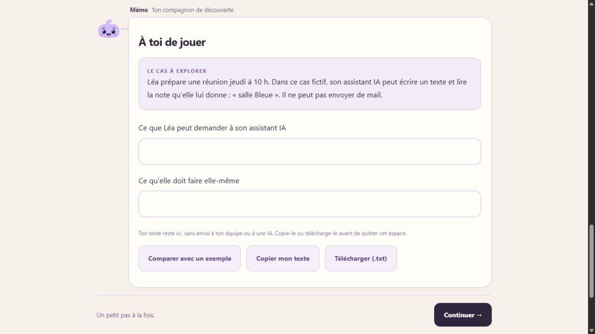

# Atelier Léa : deux réponses courtes

Le 19 octobre 2026, le propriétaire demande de supprimer les répétitions dans l'atelier de la première mission et de remplacer sa grande zone de rédaction par deux champs simples.

La mission `ent-answer-or-action` conserve son cas dans le cadre violet. Le message « Pratique · », le sous-titre d'aide, la consigne redondante, les repères préalables et le modèle de rédaction sont masqués pour cet atelier. Les deux champs portent les titres « Ce que Léa peut demander à son assistant IA » et « Ce qu’elle doit faire elle-même ». L'exemple et les critères restent accessibles après rédaction via Comparer. Le texte de confidentialité reste visible.

Les réponses restent dans le brouillon de la mission, isolé par compte et organisation comme auparavant. Copie et téléchargement regroupent les deux réponses avec leurs titres. Les autres ateliers gardent leur formulaire actuel ; aucun contrat de progression ni contenu d'évaluation ne change. Le texte historique de l'étape reste dans le catalogue pour conserver son branchement et son ID.

Recette avec les vrais composants dans une organisation fictive : arrivée à l'étape 6/8, absence des répétitions et de la grande zone de texte, saisie d'abord dans le deuxième champ puis dans le premier sans perte, copie vérifiée avec les deux titres et leurs réponses, ouverture de l'exemple commenté après rédaction. Aucun compte réel modifié. Build réussi, 260 tests réussis. L'avertissement préexistant de taille de bundle reste présent.

